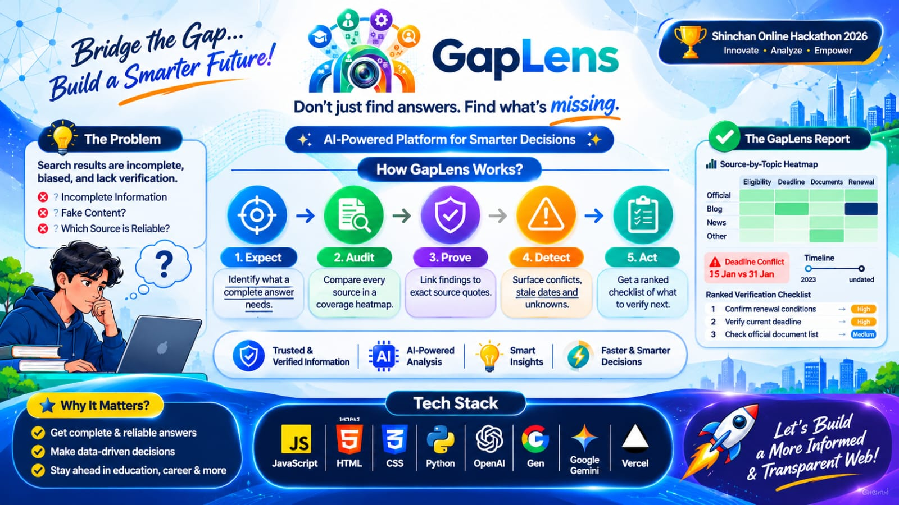

<div align="center">

# GapLens

### Don't just find answers. Find what's missing.

**An AI-assisted information gap detection platform. It audits your sources instead of summarising them.**

**Problem Statement:** Digital Dark Spot Detection & Multi-Source Evidence Intelligence

**Lead Developer:** Krishn Kushwaha

---

</div>

## The Problem
People rely on online information to make critical decisions regarding scholarships, visas, jobs, research, and governance. Traditional search engines retrieve links, while summarizers condense only what is already present on the page. Neither can identify what is **missing** (Digital Dark Spots), what is **outdated**, or where sources **contradict** one another.

## The Solution
GapLens inverts the conventional summarization workflow:
1. **Define Expected Coverage**: Establishes an essential criteria list needed for a well-informed decision.
2. **Audit Evidence Across Sources**: Compares each area against ingested sources in an interactive **Coverage Heatmap Matrix**.
3. **Verbatim Quote Verification**: Anchors findings to exact source passages to prevent model hallucinations and numerical drift.
4. **Detect Contradictions & Temporal Staleness**: Identifies conflicting numbers (e.g., income ceilings) and flags citations from past application cycles.
5. **Prioritized Verify-Next Checklist**: Calculates urgency based on importance, severity, and authority factor, complete with one-click draft inquiry emails.
6. **Re-Run Diff (Handbook Demonstration)**: Watch digital dark spots resolve from red to green in real time upon ingesting official directives.

---

## The Ideology behind Gaplens
<div align="center">


</div>
---

## Architecture & Tech Stack

GapLens is engineered strictly within a modular, optimized architecture:

```
Gaplens-main/
├── deployment/
│   ├── Dockerfile
│   └── docker-compose.yml
├── doc/
│   ├── PRD.txt
│   └── gaplens_logo.jpeg
├── gaplens/
│   ├── api/
│   │   └── server.py          # FastAPI REST endpoints & static file mounting
│   ├── app/
│   │   └── main.py            # Backend application runner
│   ├── backend/
│   │   └── pipeline.py        # Quote verification, dark spot detector, conflict engine
│   ├── db/
│   │   └── database.py        # In-memory storage & scholarship problem dataset
│   └── frontend/
│       ├── index.html         # Login screen & Glassmorphism analytics dashboard
│       ├── styles.css         # Clinic white (#f8f8ff) theme & light color scheme
│       ├── app.js             # Magnetic cursor glow, heatmap, conflict & checklist logic
│       ├── server.js          # Node.js frontend server & API proxy
|       |── bg_animation.mp4   # Official brand logo animation
│       └── gaplens_logo.jpeg  # Official brand logo
|── LICENSE                    # licence information
├── package.json               # Node.js scripts and project configuration
|── package-lock.json          # Node.js scripts
└── README.md                  # Project documentation
```

- **Backend**: Python 3.13, FastAPI, Uvicorn, Pydantic, Regex token indexing.
- **Frontend**: HTML5, Modern CSS3 (Glassmorphism, custom light palette), Vanilla JavaScript, Node.js HTTP proxy server.
- **Containerization**: Docker & Docker Compose.

---

## Design System & Theme

- **Base Background**: Clinic White (`#f8f8ff`) with ambient radial mesh.
- **Theme**: Light, clean, and professional.
- **Color Palette**:
  - **Slate Blue**: `#5B708A` (subtitles, secondary indicators, cycle tags)
  - **Medical Blue**: `#9DB7D5` (borders, progress meters)
  - **Soft Blue Tint**: `#DCEBFF` (interactive badges, info containers)
  - **Sprinkle Green**: `#10B981` (verified facts, covered cells, positive readiness)
  - **Sky Blue**: `#38BDF8` (primary highlights, quote statistics)
  - **Cherry Red**: `#E11D48` (digital dark spots, critical gaps)
  - **Baby Pink**: `#FDA4AF` (source discrepancy indicators)
- **Cursor Effects & Visual Animations**: Magnetic buttons tracking mouse pointer coordinates (`--cursor-x`, `--cursor-y`) with interactive radial luminescence, scale elevation, and spring transitions.
- **Glassmorphism**: Translucent panels (`backdrop-filter: blur(16px)`), frosted borders, and soft elevation shadows.

---

## Getting Started

### Prerequisites
- Node.js (v18+)
- Python (v3.10+)

### Quick Start

1. **Clone the repository:**
   ```bash
   git clone https://github.com/username/gaplens.git
   cd gaplens
   ```

2. **Run the Frontend (Node.js):**
   ```bash
   npm start
   ```
   Open **http://localhost:3000** in your browser.

3. **Run the Backend (Python):**
   ```bash
   npm run backend
   # or directly:
   python gaplens/app/main.py
   ```
   Backend API runs at **http://localhost:8000** (Swagger documentation: **http://localhost:8000/docs**).

4. **Docker Deployment:**
   ```bash
   docker-compose -f deployment/docker-compose.yml up --build
   ```

---

## Demo Walkthrough

1. **Authentication**:
   - Access the login page.
   - Click **"Demo Login as Krishn Kushwaha"** to enter the glassmorphism dashboard.
2. **Review Problem Scenario**:
   - Research Query: *"What should I verify before applying for this scholarship?"*
   - Initial state audits 3 sources: University Portal, Student Discussion Forum (Fall 2023 batch), and Education Gazette.
3. **Identify Digital Dark Spot & Conflicts**:
   - The Coverage Heatmap flags **Renewal Conditions** as an unaddressed **Digital Dark Spot** (0 sources covered).
   - The Source Conflicts card highlights an income threshold discrepancy (`$45,000` on official portal vs `$60,000` on forum from an older cycle).
   - Decision Readiness indicates **NOT READY**.
4. **Re-Run Diff (Handbook Demonstration)**:
   - Click the green button **"Add 2026 Handbook (Close Dark Spots)"**.
   - Watch the dark spot immediately resolve to **Covered**, coverage reaches **100%**, and the decision readiness updates to **NO CRITICAL GAPS**.
5. **Action Checklist**:
   - Review prioritized next steps.
   - Click **"Copy Draft Inquiry Email"** to copy a pre-drafted official clarification inquiry to the clipboard.

---

| Name | Role | Responsibilities |
| :--- | :--- | :--- |
| **Krishn Kushwaha** | Full-Stack & AI Engineer | Architecture, Python backend pipeline, glassmorphism UI/UX, and quote verification |

---

## License

MIT License. See [LICENSE](LICENSE) for details.
